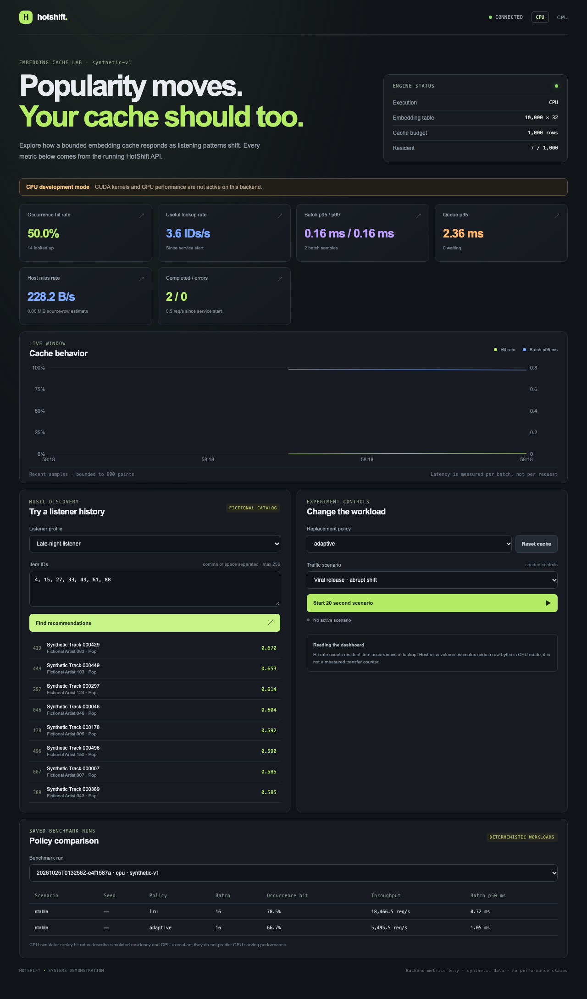

# HotShift

HotShift demonstrates a bounded embedding cache for pooled music histories. An immutable FP32 embedding table remains on the host; custom CUDA operators probe a dense GPU item map and pool cache or miss rows. The repository also contains a CPU policy simulator, deterministic synthetic traces, a bounded FastAPI service, and a React dashboard.

This is an engineering demonstration, not a trained recommender or production service. The catalog is fictional. Cache policies are practical baselines and heuristics; no policy is claimed to be novel or universally faster.



## Current status

CPU generation, reference pooling, policy simulation, API, and dashboard are implemented and validated locally. A user-provided Kaggle GPU run successfully built the CUDA extension, passed all six CUDA operator tests, and completed Compute Sanitizer checks with zero reported errors or hazards. End-to-end GPU cache validation, Nsight profiles, and GPU performance measurements are still outstanding. CPU replay statistics do not predict GPU speedups.

## Quick start

Use Python 3.11 or newer for CPU development; choose a Python release supported by the matched PyTorch CUDA build on a GPU host. Install project and API dependencies, generate the smoke fixture and catalog, then start the local CPU service and UI:

```bash
python3 -m venv .venv
source .venv/bin/activate
python3 -m pip install -e '.[dev,service]'
python3 -m hotshift.cli data generate --config configs/smoke.yaml
python3 -m hotshift.cli data catalog --config configs/smoke.yaml
python3 -m hotshift.cli test-reference --config configs/smoke.yaml
python3 -m hotshift.cli serve --config configs/smoke.yaml --backend cpu
```

In a second terminal, run `npm install --prefix frontend` and `npm run dev --prefix frontend`. Open `http://127.0.0.1:5173`. The API defaults to `http://127.0.0.1:8000`; bind it to localhost for the unauthenticated demo controls.

Generate a small CPU replay and report with:

```bash
python3 -m hotshift.cli trace generate --config configs/smoke.yaml --scenario abrupt --seed 42 --requests 1000
python3 -m hotshift.cli bench --matrix configs/smoke.yaml --smoke
python3 -m hotshift.cli report --runs artifacts/runs
```

On an NVIDIA GPU host, run the matched CUDA replay matrix with `python3 -m hotshift.cli bench-cuda --matrix configs/benchmark.yaml`. Use `--smoke` for a short functional run. This times the serialized CUDA serving path; compare only runs with matching hardware and workload metadata.

## CUDA setup

CUDA requires Linux, an NVIDIA driver and GPU, `nvcc`, a compatible host compiler, and a PyTorch build matched to the local CUDA toolkit. Install the appropriate PyTorch wheel for the target host first, then install the project. Inspect `python3 scripts/preflight.py --backend cuda`, build with `python3 -m hotshift.cli build-extension`, run `python3 -m pytest tests/cuda -m cuda`, run `bash scripts/run_sanitizers.sh`, and use `python3 -m hotshift.cli bench-cuda --matrix configs/benchmark.yaml` for GPU measurements. The Kaggle setup is documented in [docs/KAGGLE.md](docs/KAGGLE.md).

The GPU engine uses a dense `item_to_slot` map, a fixed-capacity row cache, bounded miss staging, a custom CUDA probe, and a fused custom mean-pooling kernel. The reference path deliberately synchronizes the probe for host miss planning and serializes cache updates. It is not an asynchronous overlapping pipeline. The entire embedding table stays on the CPU.

## Development and artifacts

- `configs/smoke.yaml` is for CPU correctness and UI development.
- `configs/demo.yaml` and `configs/benchmark.yaml` describe larger profiles; preflight estimates host and device capacity before GPU runs.
- Generated tables, traces, benchmark results, and profiler captures stay under ignored `artifacts/`.
- The live dashboard only displays API metrics. CPU miss bytes are a source-row estimate, not measured PCIe transfer bytes.
- Run `python3 scripts/release_check.py` for local CPU/UI checks and the CUDA gate. It returns blocked when run without a CUDA host.

Read [the architecture](docs/ARCHITECTURE.md), [developer setup](docs/DEVELOPMENT.md), [benchmark protocol](docs/BENCHMARKS.md), [demo script](docs/DEMO.md), and [implementation status](docs/STATUS.md). No redistribution license is selected yet; confirm one before publishing code for reuse.
