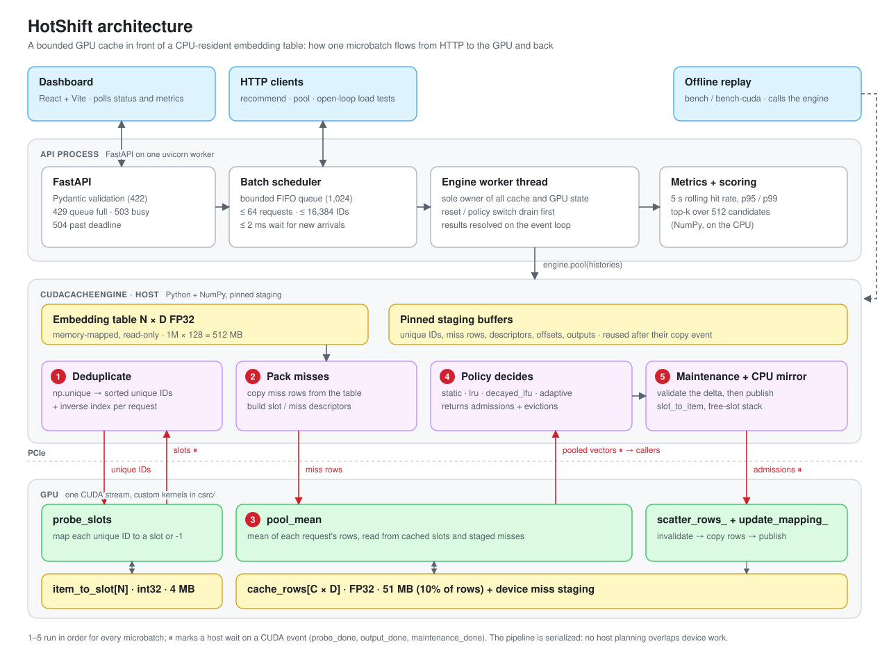

# HotShift

HotShift is a single-GPU embedding cache and recommendation serving demonstration. A full, read-only FP32 embedding table stays in CPU memory; a bounded cache of selected rows lives in GPU memory. Pooled embedding requests (mean of a listener's history rows) are served through custom CUDA kernels while cache policies adapt as item popularity shifts. A small synthetic music catalog and a live dashboard make the behavior visible.

This is an engineering portfolio project, not a trained recommender or a production service. The catalog and listeners are fictional. The adaptive policy is a practical heuristic, not a novel algorithm, and no policy is claimed to be universally better. Performance statements appear only next to the recorded runs that support them.


## Architecture

<picture>
  <source media="(prefers-color-scheme: dark)" srcset="docs/architecture-dark.svg">
  
</picture>

Custom CUDA components (all in `csrc/`): `probe_slots` (dense item→slot map lookup), `gather_rows` (validation and comparison path), `pool_mean` (fused mean pooling over cache and miss rows through descriptors), `scatter_rows_` (copies admitted rows into reserved slots), and `update_mapping_` (invalidates and publishes map entries). Transfers use standard CUDA copies through PyTorch. See [ARCHITECTURE.md](docs/ARCHITECTURE.md) for the batch order, event ordering, slot lifetime protocol, and memory equations.

Cache modes: `no_cache`, `static` (fixed set from a warmup prefix), `lru`, `decayed_lfu`, and `adaptive` (decayed frequency plus a sketch-based shift detector with bounded replacement budgets). Baselines: PyTorch `embedding_bag` on CPU, and a fully GPU-resident PyTorch table (a higher-memory reference, not an equal-budget competitor).

## Results (Tesla T4)

Measured on a Kaggle Tesla T4 with a 1M × 128 FP32 table (512 MB) and a cache budget of 10% of its rows. All GPU gates pass: 157 tests with no CUDA skips, and Compute Sanitizer memcheck, racecheck, initcheck, and synccheck are clean. Every configuration's outputs were verified against the CPU reference. Summaries, logs, and the full report are in [evidence/t4-2026-10-26/](evidence/t4-2026-10-26/).

Stable traffic, median requests/s over 3 seeds (hit rate in parentheses):

| Engine | Batch 1 | Batch 16 | Batch 64 | GPU memory |
| --- | ---: | ---: | ---: | ---: |
| `no_cache` | 1,459 | 16,178 | 41,108 | 13 MB |
| `static` (0.89) | 1,487 | 17,669 | 47,968 | 64.5 MB |
| `lru` (0.89) | 875 | 6,229 | 10,502 | 64.5 MB |
| `adaptive` (0.89) | 1,174 | 10,438 | 20,712 | 64.5 MB |
| `torch_gpu_resident` (full-table reference) | 4,336 | 42,414 | 98,260 | 512 MB |


What the measurements show:

- **The cache saves memory and bandwidth, not time, on this GPU.** It uses 8× less device memory than the full table and cuts host→device bytes by up to 75%, but only the static cache is faster than no caching (+9% to +17% at batch 16–64). The dynamic policies are 1.2× to 4.8× slower.
- **The bottleneck is host-side Python, not the GPU.** Kernels take about 0.25 ms per batch; LRU's policy bookkeeping alone takes 3.2 ms at batch 64 ([PERFORMANCE.md](docs/PERFORMANCE.md), P5).
- **Adaptive trades recovery speed for stability.** Its bounded replacement budget avoids churn but recovers from an abrupt shift 10× slower than LRU (20,000 vs 2,000 requests).
- **The HTTP service sustains 250 req/s** with p99 13 ms and fails its objective at 400 req/s, so the single Python worker, not the engine, bounds serving.

These results describe one GPU and one workload, where the table fits on the device and PCIe is fast. The design targets the opposite case, tables larger than GPU memory, which this hardware did not test. Full methodology, sweeps, ablations, and losing cases: [BENCHMARKS.md](docs/BENCHMARKS.md).

## Quick start (CPU development mode)

Requires Python 3.11+ and Node 22. CPU mode runs everything except the CUDA kernels and is labeled as CPU in the API and UI.

```bash
python3 -m venv .venv && source .venv/bin/activate
python3 -m pip install -r requirements/cpu-py311-linux.lock   # exact pins (Linux, Python 3.11)
python3 -m pip install -e '.[dev,service]'                     # or this alone on other platforms
python3 -m hotshift.cli data generate --config configs/smoke.yaml
python3 -m hotshift.cli data catalog --config configs/smoke.yaml
python3 -m hotshift.cli test-reference --config configs/smoke.yaml
python3 -m hotshift.cli serve --config configs/smoke.yaml --backend cpu
```

In a second terminal: `npm ci --prefix frontend && npm run dev --prefix frontend`, then open http://127.0.0.1:5173. Or run both with Docker: `docker compose --profile cpu up --build`.

Reproduce a CPU replay benchmark and report:

```bash
python3 -m hotshift.cli trace generate --config configs/smoke.yaml --scenario abrupt --seed 42
python3 -m hotshift.cli bench --matrix configs/smoke.yaml --smoke
python3 -m hotshift.cli report --runs artifacts/runs
```

## GPU mode

Requirements: Linux, an NVIDIA GPU and driver, a CUDA toolkit with `nvcc`, a host compiler, and a PyTorch CUDA build matched to that toolkit. An 8 GB GPU handles the smoke and demo profiles; the standard benchmark needs about 0.6 GB of device memory plus allocator slack (see the capacity estimate from `scripts/preflight.py --config configs/benchmark.yaml`). Apple Silicon cannot run CUDA.

```bash
python3 scripts/preflight.py --backend cuda --deep      # device, toolkit, kernel run, profiler counters
python3 -m hotshift.cli build-extension
python3 -m pytest tests/cuda -m cuda
bash scripts/run_sanitizers.sh
python3 -m hotshift.cli serve --config configs/demo.yaml --backend cuda
python3 -m hotshift.cli bench-cuda --matrix configs/benchmark.yaml
```

GPU mode fails clearly when CUDA is unavailable and never falls back to CPU. Run one worker only: each worker would own a separate cache and GPU context.

## Documents

[Status](docs/STATUS.md) · [Architecture](docs/ARCHITECTURE.md) · [Development](docs/DEVELOPMENT.md) · [Benchmarks](docs/BENCHMARKS.md) · [Performance log](docs/PERFORMANCE.md) · [Decisions](docs/DECISIONS.md) · [Demo script](docs/DEMO.md) · [Release checklist](docs/RELEASE.md) · [Kaggle GPU runs](docs/KAGGLE.md)

## Credits and license

Related systems that informed the design (no code was copied): NVIDIA's [nv-embedding-cache](https://github.com/NVIDIA/nv-embedding-cache), Meta's [FBGEMM](https://docs.pytorch.org/FBGEMM/) embedding operators, and the PyTorch custom C++/CUDA operator tutorial. HotShift is not endorsed by NVIDIA, Meta, or PyTorch. The dense direct map is a simple array, not a hash table. Released under the [MIT License](LICENSE).
