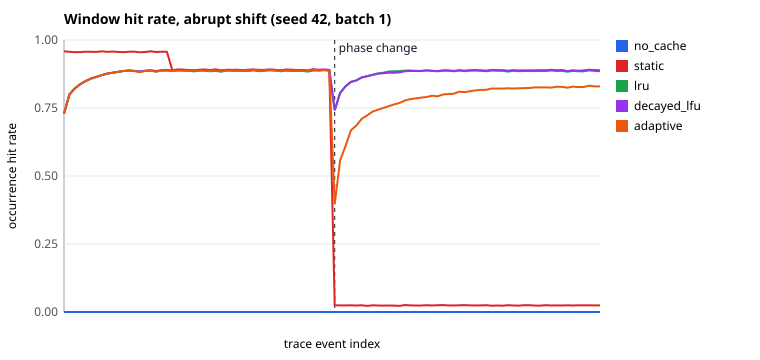
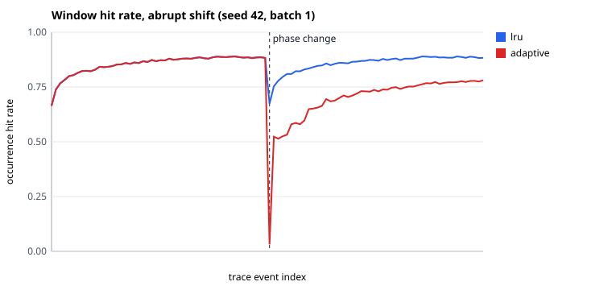
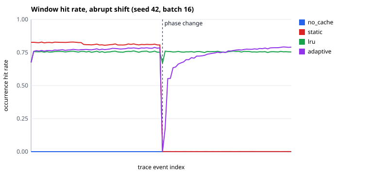
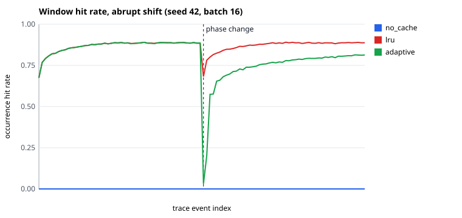

# HotShift Benchmark Report

Generated from completed artifacts only; incomplete runs are skipped. CPU replay timing is not GPU timing. CUDA batch wall time includes host planning, transfers, synchronization, kernels, and policy maintenance. Medians are across repeated seeds; individual runs remain in each run's summary.json. Compare only rows with matching hardware, data, traces, and budget.

## Kernel microbenchmark `20261026T013214Z-kernels-2a46fa6b` (Tesla T4)

Median CUDA event span per call; device operation only.

| D | Bag length | Unique | Fused pool us | Gather + embedding_bag us | Resident embedding_bag us | Gather/fused | Max abs error |
| ---: | ---: | ---: | ---: | ---: | ---: | ---: | ---: |
| 32 | 1 | 64 | 24.67 | 49.36 | 28.43 | 2.00 | 0.00e+00 |
| 32 | 8 | 511 | 25.94 | 44.27 | 27.17 | 1.71 | 0.00e+00 |
| 32 | 32 | 2016 | 38.16 | 45.49 | 29.86 | 1.19 | 0.00e+00 |
| 32 | 128 | 7708 | 108.38 | 74.03 | 59.17 | 0.68 | 0.00e+00 |
| 32 | 256 | 14513 | 200.91 | 130.05 | 100.37 | 0.65 | 0.00e+00 |
| 128 | 1 | 64 | 24.46 | 43.01 | 29.06 | 1.76 | 0.00e+00 |
| 128 | 8 | 511 | 24.53 | 42.93 | 27.01 | 1.75 | 0.00e+00 |
| 128 | 32 | 2008 | 38.37 | 43.46 | 30.14 | 1.13 | 0.00e+00 |
| 128 | 128 | 7692 | 122.91 | 126.98 | 68.26 | 1.03 | 0.00e+00 |
| 128 | 256 | 14511 | 258.08 | 232.34 | 128.42 | 0.90 | 0.00e+00 |
| 256 | 1 | 64 | 24.38 | 44.00 | 28.66 | 1.80 | 0.00e+00 |
| 256 | 8 | 510 | 24.58 | 43.58 | 30.06 | 1.77 | 0.00e+00 |
| 256 | 32 | 2023 | 38.94 | 55.26 | 30.56 | 1.42 | 0.00e+00 |
| 256 | 128 | 7673 | 141.70 | 185.22 | 80.10 | 1.31 | 0.00e+00 |
| 256 | 256 | 14447 | 267.33 | 334.37 | 139.30 | 1.25 | 0.00e+00 |

## Run `20261026T013249Z-cuda-67ce68c2`

- Backend: **cuda** on Tesla T4; smoke: False
- Commit: `57cbca19aee29b37ae9fb11f79f9c3c057621e3b`; dirty tree: False; release eligible: True
- Table: 1000000 x 128; window: 1000 trace requests
- Raw data: `evidence/t4-2026-10-26/runs/20261026T013249Z-cuda-67ce68c2/summary.json`, `windows.csv`, `batch_samples.csv.gz`

| Scenario | Policy | Variant | Batch | Cond. | Cache frac. | n | Hit rate (median) | Requests/s median [min, max] | Batch p99 ms (median) | H2D bytes (median) | Recovery | Outputs |
| --- | --- | --- | ---: | --- | ---: | ---: | ---: | --- | ---: | ---: | --- | --- |
| abrupt | adaptive | optimized | 1 | warm | 0.100 | 3 | 0.8202 | 1165.5 [1160.4, 1173.6] | 1.5467 | 488914612 | recovered, recovered, recovered (median 21000 req) | pass |
| abrupt | decayed_lfu | optimized | 1 | warm | 0.100 | 3 | 0.8827 | 820.0 [809.0, 820.2] | 1.9256 | 371218492 | recovered, recovered, recovered (median 2000 req) | pass |
| abrupt | lru | optimized | 1 | warm | 0.100 | 3 | 0.8810 | 880.4 [875.8, 883.6] | 1.6753 | 375483452 | recovered, recovered, recovered (median 2000 req) | pass |
| abrupt | no_cache | optimized | 1 | warm | 0.100 | 3 | 0.0000 | 1468.5 [1455.3, 1473.4] | 0.9779 | 1778904756 | not_applicable, not_applicable, not_applicable | pass |
| abrupt | static | optimized | 1 | warm | 0.100 | 3 | 0.3499 | 1495.7 [1470.7, 1505.1] | 0.9623 | 1199841972 | not_recovered, not_recovered, not_recovered | pass |
| abrupt | torch_cpu | optimized | 1 | warm | 0.100 | 3 | n/a | 5555.9 [5548.4, 5569.4] | 0.2911 | n/a | not_applicable, not_applicable, not_applicable | pass |
| abrupt | torch_gpu_resident | optimized | 1 | warm | 0.100 | 3 | 1.0000 | 4341.0 [4332.3, 4364.3] | 0.3624 | 37135568 | not_applicable, not_applicable, not_applicable | pass |
| abrupt | adaptive | optimized | 16 | warm | 0.100 | 3 | 0.8226 | 9823.4 [9821.8, 9935.2] | 4.5768 | 468573188 | recovered, recovered, recovered (median 20000 req) | pass |
| abrupt | decayed_lfu | optimized | 16 | warm | 0.100 | 3 | 0.8826 | 5423.4 [5351.0, 5509.1] | 4.7116 | 359491944 | recovered, recovered, recovered (median 2000 req) | pass |
| abrupt | lru | optimized | 16 | warm | 0.100 | 3 | 0.8809 | 6253.9 [6207.4, 6341.9] | 3.4400 | 363755224 | recovered, recovered, recovered (median 2000 req) | pass |
| abrupt | no_cache | optimized | 16 | warm | 0.100 | 3 | 0.0000 | 16125.3 [16123.9, 16415.6] | 1.3910 | 1294579716 | not_applicable, not_applicable, not_applicable | pass |
| abrupt | static | optimized | 16 | warm | 0.100 | 3 | 0.3499 | 16799.5 [16603.5, 16853.4] | 1.3296 | 896034820 | not_recovered, not_recovered, not_recovered | pass |
| abrupt | torch_cpu | optimized | 16 | warm | 0.100 | 3 | n/a | 46590.3 [44356.7, 47160.7] | 0.4878 | n/a | not_applicable, not_applicable, not_applicable | pass |
| abrupt | torch_gpu_resident | optimized | 16 | warm | 0.100 | 3 | 1.0000 | 41710.0 [41300.0, 42866.0] | 0.5699 | 36535888 | not_applicable, not_applicable, not_applicable | pass |
| abrupt | adaptive | optimized | 64 | warm | 0.100 | 3 | 0.8288 | 18142.4 [18137.6, 18184.7] | 12.1588 | 446235340 | recovered, recovered, recovered (median 18000 req) | pass |
| abrupt | decayed_lfu | optimized | 64 | warm | 0.100 | 3 | 0.8822 | 8464.2 [8448.7, 8515.9] | 13.0443 | 354003708 | recovered, recovered, recovered (median 2000 req) | pass |
| abrupt | lru | optimized | 64 | warm | 0.100 | 3 | 0.8805 | 10482.8 [10385.6, 10683.7] | 9.6860 | 358236748 | recovered, recovered, recovered (median 2000 req) | pass |
| abrupt | no_cache | optimized | 64 | warm | 0.100 | 3 | 0.0000 | 40478.3 [40303.0, 40708.3] | 2.3901 | 1063388608 | not_applicable, not_applicable, not_applicable | pass |
| abrupt | static | optimized | 64 | warm | 0.100 | 3 | 0.3499 | 42864.7 [42793.3, 44011.0] | 1.9445 | 753696192 | not_recovered, not_recovered, not_recovered | pass |
| abrupt | torch_cpu | optimized | 64 | warm | 0.100 | 3 | n/a | 95560.6 [90728.4, 96615.5] | 0.8545 | n/a | not_applicable, not_applicable, not_applicable | pass |
| abrupt | torch_gpu_resident | optimized | 64 | warm | 0.100 | 3 | 1.0000 | 96745.8 [94601.3, 97122.0] | 0.8121 | 36505808 | not_applicable, not_applicable, not_applicable | pass |
| brief_burst | adaptive | optimized | 1 | warm | 0.100 | 3 | 0.8551 | 1173.6 [1171.9, 1181.5] | 1.5123 | 403337908 | n/a | pass |
| brief_burst | decayed_lfu | optimized | 1 | warm | 0.100 | 3 | 0.8790 | 820.4 [814.7, 827.3] | 1.9434 | 380584492 | n/a | pass |
| brief_burst | lru | optimized | 1 | warm | 0.100 | 3 | 0.8760 | 877.5 [876.6, 880.4] | 1.6912 | 388092412 | n/a | pass |
| brief_burst | no_cache | optimized | 1 | warm | 0.100 | 3 | 0.0000 | 1464.9 [1454.8, 1466.0] | 0.9860 | 1778904756 | n/a | pass |
| brief_burst | static | optimized | 1 | warm | 0.100 | 3 | 0.7824 | 1499.2 [1490.1, 1499.3] | 0.9665 | 502800940 | n/a | pass |
| brief_burst | torch_cpu | optimized | 1 | warm | 0.100 | 3 | n/a | 5527.1 [5468.0, 5556.4] | 0.2944 | n/a | n/a | pass |
| brief_burst | torch_gpu_resident | optimized | 1 | warm | 0.100 | 3 | 1.0000 | 4348.2 [4308.0, 4377.5] | 0.3639 | 37135568 | n/a | pass |
| brief_burst | adaptive | optimized | 16 | warm | 0.100 | 3 | 0.8557 | 10107.2 [9954.0, 10279.8] | 4.0714 | 382326184 | n/a | pass |
| brief_burst | decayed_lfu | optimized | 16 | warm | 0.100 | 3 | 0.8789 | 5411.7 [5288.3, 5417.6] | 4.7181 | 368862424 | n/a | pass |
| brief_burst | lru | optimized | 16 | warm | 0.100 | 3 | 0.8759 | 6150.6 [6010.6, 6189.5] | 3.5742 | 376362504 | n/a | pass |
| brief_burst | no_cache | optimized | 16 | warm | 0.100 | 3 | 0.0000 | 16244.0 [15728.6, 16290.1] | 1.4624 | 1294579716 | n/a | pass |
| brief_burst | static | optimized | 16 | warm | 0.100 | 3 | 0.7824 | 17509.7 [17425.7, 17668.8] | 1.2076 | 432868348 | n/a | pass |
| brief_burst | torch_cpu | optimized | 16 | warm | 0.100 | 3 | n/a | 45111.5 [43802.8, 45541.5] | 0.5197 | n/a | n/a | pass |
| brief_burst | torch_gpu_resident | optimized | 16 | warm | 0.100 | 3 | 1.0000 | 42813.9 [40873.9, 43027.1] | 0.4746 | 36535888 | n/a | pass |
| brief_burst | adaptive | optimized | 64 | warm | 0.100 | 3 | 0.8581 | 19358.6 [19255.5, 19868.9] | 8.6985 | 367963072 | n/a | pass |
| brief_burst | decayed_lfu | optimized | 64 | warm | 0.100 | 3 | 0.8785 | 8180.7 [8044.9, 8225.1] | 13.4041 | 363378668 | n/a | pass |
| brief_burst | lru | optimized | 64 | warm | 0.100 | 3 | 0.8755 | 10144.9 [9979.3, 10330.7] | 9.8252 | 370841788 | n/a | pass |
| brief_burst | no_cache | optimized | 64 | warm | 0.100 | 3 | 0.0000 | 41265.0 [40707.3, 41479.8] | 1.9491 | 1063388608 | n/a | pass |
| brief_burst | static | optimized | 64 | warm | 0.100 | 3 | 0.7824 | 45992.1 [45795.5, 46908.2] | 1.7751 | 400184856 | n/a | pass |
| brief_burst | torch_cpu | optimized | 64 | warm | 0.100 | 3 | n/a | 94413.3 [93860.5, 96103.7] | 0.9339 | n/a | n/a | pass |
| brief_burst | torch_gpu_resident | optimized | 64 | warm | 0.100 | 3 | 1.0000 | 95730.8 [93060.5, 98202.8] | 0.8646 | 36505808 | n/a | pass |
| stable | adaptive | optimized | 1 | warm | 0.100 | 3 | 0.8892 | 1173.9 [1162.6, 1180.6] | 1.4938 | 332144820 | n/a | pass |
| stable | decayed_lfu | optimized | 1 | warm | 0.100 | 3 | 0.8894 | 815.4 [811.6, 827.5] | 1.9542 | 354599932 | n/a | pass |
| stable | lru | optimized | 1 | warm | 0.100 | 3 | 0.8865 | 874.6 [860.3, 876.8] | 1.6998 | 361888892 | n/a | pass |
| stable | no_cache | optimized | 1 | warm | 0.100 | 3 | 0.0000 | 1458.8 [1458.1, 1466.0] | 0.9799 | 1778904756 | n/a | pass |
| stable | static | optimized | 1 | warm | 0.100 | 3 | 0.8901 | 1487.0 [1478.4, 1498.8] | 0.9903 | 328770892 | n/a | pass |
| stable | torch_cpu | optimized | 1 | warm | 0.100 | 3 | n/a | 5573.8 [5548.1, 5610.5] | 0.2944 | n/a | n/a | pass |
| stable | torch_gpu_resident | optimized | 1 | warm | 0.100 | 3 | 1.0000 | 4335.8 [4278.1, 4342.6] | 0.3665 | 37135568 | n/a | pass |
| stable | adaptive | optimized | 16 | warm | 0.100 | 3 | 0.8895 | 10438.4 [10386.9, 10584.3] | 3.8842 | 319705604 | n/a | pass |
| stable | decayed_lfu | optimized | 16 | warm | 0.100 | 3 | 0.8894 | 5476.5 [5414.9, 5543.8] | 4.3262 | 342862744 | n/a | pass |
| stable | lru | optimized | 16 | warm | 0.100 | 3 | 0.8865 | 6229.3 [6070.0, 6292.7] | 3.4777 | 350152264 | n/a | pass |
| stable | no_cache | optimized | 16 | warm | 0.100 | 3 | 0.0000 | 16178.4 [15989.1, 16413.0] | 1.4095 | 1294579716 | n/a | pass |
| stable | static | optimized | 16 | warm | 0.100 | 3 | 0.8901 | 17668.9 [17519.0, 17818.2] | 1.2178 | 317092860 | n/a | pass |
| stable | torch_cpu | optimized | 16 | warm | 0.100 | 3 | n/a | 44868.5 [44649.4, 48385.5] | 0.5329 | n/a | n/a | pass |
| stable | torch_gpu_resident | optimized | 16 | warm | 0.100 | 3 | 1.0000 | 42414.1 [41566.4, 42853.1] | 0.6317 | 36535888 | n/a | pass |
| stable | adaptive | optimized | 64 | warm | 0.100 | 3 | 0.8902 | 20711.7 [20570.3, 20819.0] | 7.3487 | 312627648 | n/a | pass |
| stable | decayed_lfu | optimized | 64 | warm | 0.100 | 3 | 0.8894 | 8612.6 [8577.7, 8616.0] | 11.3394 | 337362188 | n/a | pass |
| stable | lru | optimized | 64 | warm | 0.100 | 3 | 0.8865 | 10502.4 [10262.7, 10543.8] | 9.6762 | 344622588 | n/a | pass |
| stable | no_cache | optimized | 64 | warm | 0.100 | 3 | 0.0000 | 41107.8 [41019.9, 42075.9] | 1.8818 | 1063388608 | n/a | pass |
| stable | static | optimized | 64 | warm | 0.100 | 3 | 0.8901 | 47968.2 [46212.4, 47981.6] | 1.6006 | 311604248 | n/a | pass |
| stable | torch_cpu | optimized | 64 | warm | 0.100 | 3 | n/a | 98856.1 [94701.1, 98957.6] | 0.8256 | n/a | n/a | pass |
| stable | torch_gpu_resident | optimized | 64 | warm | 0.100 | 3 | 1.0000 | 98259.6 [97712.2, 100922.8] | 0.7895 | 36505808 | n/a | pass |
| uniform | adaptive | optimized | 1 | warm | 0.100 | 3 | 0.0999 | 1095.9 [1083.1, 1099.1] | 1.5251 | 2157062308 | n/a | pass |
| uniform | decayed_lfu | optimized | 1 | warm | 0.100 | 3 | 0.1002 | 574.5 [574.2, 580.1] | 3.8715 | 2348871188 | n/a | pass |
| uniform | lru | optimized | 1 | warm | 0.100 | 3 | 0.1001 | 773.0 [757.2, 775.8] | 2.2664 | 2349268324 | n/a | pass |
| uniform | no_cache | optimized | 1 | warm | 0.100 | 3 | 0.0000 | 1449.2 [1443.6, 1469.6] | 0.9983 | 2385547940 | n/a | pass |
| uniform | static | optimized | 1 | warm | 0.100 | 3 | 0.1000 | 1472.3 [1460.3, 1474.5] | 0.9810 | 2155994788 | n/a | pass |
| uniform | torch_cpu | optimized | 1 | warm | 0.100 | 3 | n/a | 5773.3 [5752.8, 5795.2] | 0.2797 | n/a | n/a | pass |
| uniform | torch_gpu_resident | optimized | 1 | warm | 0.100 | 3 | 1.0000 | 4331.1 [4322.2, 4333.3] | 0.3708 | 37135568 | n/a | pass |
| uniform | adaptive | optimized | 16 | warm | 0.100 | 3 | 0.0999 | 5425.3 [5367.4, 5478.3] | 10.7154 | 2155523216 | n/a | pass |
| uniform | decayed_lfu | optimized | 16 | warm | 0.100 | 3 | 0.1002 | 1549.4 [1529.8, 1567.5] | 15.1000 | 2347259040 | n/a | pass |
| uniform | lru | optimized | 16 | warm | 0.100 | 3 | 0.1001 | 3135.7 [3113.6, 3145.4] | 8.4280 | 2347738928 | n/a | pass |
| uniform | no_cache | optimized | 16 | warm | 0.100 | 3 | 0.0000 | 14145.0 [13237.3, 14421.9] | 1.3884 | 2384013968 | n/a | pass |
| uniform | static | optimized | 16 | warm | 0.100 | 3 | 0.1000 | 14396.7 [14330.2, 14662.4] | 1.4995 | 2154541712 | n/a | pass |
| uniform | torch_cpu | optimized | 16 | warm | 0.100 | 3 | n/a | 45105.0 [44775.9, 46588.6] | 0.5009 | n/a | n/a | pass |
| uniform | torch_gpu_resident | optimized | 16 | warm | 0.100 | 3 | 1.0000 | 41294.1 [41065.2, 42310.9] | 0.4858 | 36535888 | n/a | pass |
| uniform | adaptive | optimized | 64 | warm | 0.100 | 3 | 0.0998 | 7035.6 [7005.0, 7057.3] | 21.5313 | 2152659012 | n/a | pass |
| uniform | decayed_lfu | optimized | 64 | warm | 0.100 | 3 | 0.1002 | 1700.0 [1699.3, 1729.6] | 64.3728 | 2343924596 | n/a | pass |
| uniform | lru | optimized | 64 | warm | 0.100 | 3 | 0.1001 | 3922.6 [3901.4, 3951.3] | 30.6733 | 2344700228 | n/a | pass |
| uniform | no_cache | optimized | 64 | warm | 0.100 | 3 | 0.0000 | 31817.6 [31469.7, 32145.6] | 2.8197 | 2380889668 | n/a | pass |
| uniform | static | optimized | 64 | warm | 0.100 | 3 | 0.1000 | 33105.5 [32795.0, 33375.5] | 2.2763 | 2151718468 | n/a | pass |
| uniform | torch_cpu | optimized | 64 | warm | 0.100 | 3 | n/a | 80539.6 [79641.0, 83631.7] | 0.9735 | n/a | n/a | pass |
| uniform | torch_gpu_resident | optimized | 64 | warm | 0.100 | 3 | 1.0000 | 95873.0 [93385.2, 95968.0] | 0.9120 | 36505808 | n/a | pass |

### Unfavorable and low-benefit cases

- abrupt, batch 1, warm, cache 0.100: adaptive throughput is below static, no_cache.
- abrupt, batch 1, warm, cache 0.100: lru, decayed_lfu, adaptive slower than no cache.
- abrupt, batch 16, warm, cache 0.100: adaptive throughput is below static, no_cache.
- abrupt, batch 16, warm, cache 0.100: lru, decayed_lfu, adaptive slower than no cache.
- abrupt, batch 64, warm, cache 0.100: adaptive throughput is below static, no_cache.
- abrupt, batch 64, warm, cache 0.100: lru, decayed_lfu, adaptive slower than no cache.
- brief_burst, batch 1, warm, cache 0.100: adaptive throughput is below static, no_cache.
- brief_burst, batch 1, warm, cache 0.100: lru, decayed_lfu, adaptive slower than no cache.
- brief_burst, batch 16, warm, cache 0.100: adaptive throughput is below static, no_cache.
- brief_burst, batch 16, warm, cache 0.100: lru, decayed_lfu, adaptive slower than no cache.
- brief_burst, batch 64, warm, cache 0.100: adaptive throughput is below static, no_cache.
- brief_burst, batch 64, warm, cache 0.100: lru, decayed_lfu, adaptive slower than no cache.
- stable, batch 1, warm, cache 0.100: adaptive throughput is below static, no_cache.
- stable, batch 1, warm, cache 0.100: lru, decayed_lfu, adaptive slower than no cache.
- stable, batch 16, warm, cache 0.100: adaptive throughput is below static, no_cache.
- stable, batch 16, warm, cache 0.100: lru, decayed_lfu, adaptive slower than no cache.
- stable, batch 64, warm, cache 0.100: adaptive throughput is below static, no_cache.
- stable, batch 64, warm, cache 0.100: lru, decayed_lfu, adaptive slower than no cache.
- uniform, batch 1, warm, cache 0.100: adaptive throughput is below static, no_cache.
- uniform, batch 1, warm, cache 0.100: lru, decayed_lfu, adaptive slower than no cache.
- uniform, batch 16, warm, cache 0.100: adaptive throughput is below static, no_cache.
- uniform, batch 16, warm, cache 0.100: lru, decayed_lfu, adaptive slower than no cache.
- uniform, batch 64, warm, cache 0.100: adaptive throughput is below static, no_cache.
- uniform, batch 64, warm, cache 0.100: lru, decayed_lfu, adaptive slower than no cache.

## Run `20261026T041525Z-cuda-cf672a53`

- Backend: **cuda** on Tesla T4; smoke: False
- Commit: `57cbca19aee29b37ae9fb11f79f9c3c057621e3b`; dirty tree: False; release eligible: True
- Table: 1000000 x 128; window: 300 trace requests
- Raw data: `evidence/t4-2026-10-26/runs/20261026T041525Z-cuda-cf672a53/summary.json`, `windows.csv`, `batch_samples.csv.gz`

| Scenario | Policy | Variant | Batch | Cond. | Cache frac. | n | Hit rate (median) | Requests/s median [min, max] | Batch p99 ms (median) | H2D bytes (median) | Recovery | Outputs |
| --- | --- | --- | ---: | --- | ---: | ---: | ---: | --- | ---: | ---: | --- | --- |
| abrupt | adaptive | host_admission | 1 | warm | 0.100 | 3 | 0.7639 | 1043.8 [1034.1, 1055.0] | 1.6734 | 210892568 | not_recovered, not_recovered, not_recovered | pass |
| abrupt | adaptive | optimized | 1 | warm | 0.100 | 3 | 0.7639 | 1055.4 [1045.5, 1064.1] | 1.6822 | 184658712 | not_recovered, not_recovered, not_recovered | pass |
| abrupt | adaptive | pageable_staging | 1 | warm | 0.100 | 3 | 0.7639 | 1017.0 [1011.6, 1027.1] | 1.6881 | 184658712 | not_recovered, not_recovered, not_recovered | pass |
| abrupt | lru | host_admission | 1 | warm | 0.100 | 3 | 0.8659 | 852.1 [851.5, 853.6] | 1.7383 | 215395672 | recovered, recovered, recovered (median 1200 req) | pass |
| abrupt | lru | optimized | 1 | warm | 0.100 | 3 | 0.8659 | 860.9 [859.4, 863.3] | 1.7149 | 123177816 | recovered, recovered, recovered (median 1200 req) | pass |
| abrupt | lru | pageable_staging | 1 | warm | 0.100 | 3 | 0.8659 | 848.9 [835.0, 852.4] | 1.7585 | 123177816 | recovered, recovered, recovered (median 1200 req) | pass |
| abrupt | adaptive | host_admission | 64 | warm | 0.100 | 3 | 0.7797 | 15697.7 [15260.4, 16094.5] | 14.5473 | 190202112 | not_recovered, not_recovered, not_recovered | pass |
| abrupt | adaptive | optimized | 64 | warm | 0.100 | 3 | 0.7797 | 15689.3 [15624.0, 16014.0] | 14.6452 | 163968256 | not_recovered, not_recovered, not_recovered | pass |
| abrupt | adaptive | pageable_staging | 64 | warm | 0.100 | 3 | 0.7797 | 15301.0 [15183.7, 15597.9] | 13.8210 | 163968256 | not_recovered, not_recovered, not_recovered | pass |
| abrupt | lru | host_admission | 64 | warm | 0.100 | 3 | 0.8641 | 10993.0 [10865.6, 11137.9] | 9.1077 | 210283176 | recovered, recovered, recovered (median 1500 req) | pass |
| abrupt | lru | optimized | 64 | warm | 0.100 | 3 | 0.8641 | 11035.4 [11013.0, 11310.8] | 8.8973 | 118089896 | recovered, recovered, recovered (median 1500 req) | pass |
| abrupt | lru | pageable_staging | 64 | warm | 0.100 | 3 | 0.8641 | 10787.6 [10747.5, 10805.7] | 9.4501 | 118089896 | recovered, recovered, recovered (median 1500 req) | pass |

### Unfavorable and low-benefit cases

- No configuration in this run had adaptive below a simpler policy or a cache below no cache on median throughput.

## Run `20261026T043300Z-cuda-a80b131d`

- Backend: **cuda** on Tesla T4; smoke: False
- Commit: `57cbca19aee29b37ae9fb11f79f9c3c057621e3b`; dirty tree: False; release eligible: True
- Table: 1000000 x 128; window: 500 trace requests
- Raw data: `evidence/t4-2026-10-26/runs/20261026T043300Z-cuda-a80b131d/summary.json`, `windows.csv`, `batch_samples.csv.gz`

| Scenario | Policy | Variant | Batch | Cond. | Cache frac. | n | Hit rate (median) | Requests/s median [min, max] | Batch p99 ms (median) | H2D bytes (median) | Recovery | Outputs |
| --- | --- | --- | ---: | --- | ---: | ---: | ---: | --- | ---: | ---: | --- | --- |
| abrupt | adaptive | optimized | 16 | warm | 0.010 | 3 | 0.7388 | 9379.1 [9328.0, 9402.2] | 4.8025 | 321676088 | recovered, recovered, recovered (median 6000 req) | pass |
| abrupt | lru | optimized | 16 | warm | 0.010 | 3 | 0.7551 | 6358.3 [6030.7, 6571.9] | 3.8651 | 339589596 | recovered, recovered, recovered (median 1000 req) | pass |
| abrupt | no_cache | optimized | 16 | warm | 0.010 | 3 | 0.0000 | 15794.3 [15707.7, 16053.4] | 1.2406 | 649180472 | not_applicable, not_applicable, not_applicable | pass |
| abrupt | static | optimized | 16 | warm | 0.010 | 3 | 0.3041 | 16629.3 [16550.9, 16754.1] | 1.1966 | 499685100 | not_recovered, not_recovered, not_recovered | pass |
| abrupt | adaptive | optimized | 16 | warm | 0.050 | 3 | 0.7715 | 9430.8 [9395.9, 9590.8] | 4.9122 | 284249400 | recovered, recovered, recovered (median 13000 req) | pass |
| abrupt | lru | optimized | 16 | warm | 0.050 | 3 | 0.8443 | 6344.5 [6336.6, 6426.4] | 3.6676 | 228005116 | recovered, recovered, recovered (median 1000 req) | pass |
| abrupt | no_cache | optimized | 16 | warm | 0.050 | 3 | 0.0000 | 15752.5 [15675.7, 15916.9] | 1.2617 | 649180472 | not_applicable, not_applicable, not_applicable | pass |
| abrupt | static | optimized | 16 | warm | 0.050 | 3 | 0.3269 | 16148.0 [16108.6, 16741.7] | 1.4752 | 473165112 | not_recovered, not_recovered, not_recovered | pass |
| abrupt | adaptive | optimized | 16 | warm | 0.100 | 3 | 0.7908 | 9354.2 [9191.7, 9408.0] | 5.2526 | 262497072 | recovered, recovered, recovered (median 19000 req) | pass |
| abrupt | lru | optimized | 16 | warm | 0.100 | 3 | 0.8753 | 6441.5 [6377.6, 6609.0] | 3.5507 | 188911680 | recovered, recovered, recovered (median 1500 req) | pass |
| abrupt | no_cache | optimized | 16 | warm | 0.100 | 3 | 0.0000 | 15750.8 [15521.9, 15998.6] | 1.2947 | 649180472 | not_applicable, not_applicable, not_applicable | pass |
| abrupt | static | optimized | 16 | warm | 0.100 | 3 | 0.3462 | 16776.4 [16488.1, 17047.5] | 1.2126 | 453028476 | not_recovered, not_recovered, not_recovered | pass |
| abrupt | adaptive | optimized | 16 | warm | 0.250 | 3 | 0.8879 | 8389.7 [8380.2, 8395.2] | 3.9803 | 166375792 | recovered, recovered, recovered (median 1500 req) | pass |
| abrupt | lru | optimized | 16 | warm | 0.250 | 3 | 0.8929 | 6691.1 [6682.1, 6770.4] | 3.0530 | 163904800 | recovered, recovered, recovered (median 1500 req) | pass |
| abrupt | no_cache | optimized | 16 | warm | 0.250 | 3 | 0.0000 | 16027.8 [16026.8, 16145.0] | 1.2098 | 649180472 | not_applicable, not_applicable, not_applicable | pass |
| abrupt | static | optimized | 16 | warm | 0.250 | 3 | 0.3462 | 16762.5 [16459.0, 16987.4] | 1.1659 | 453028476 | not_recovered, not_recovered, not_recovered | pass |
| stable | adaptive | optimized | 16 | warm | 0.010 | 3 | 0.7873 | 10104.4 [9966.5, 10171.9] | 4.1668 | 276331320 | n/a | pass |
| stable | lru | optimized | 16 | warm | 0.010 | 3 | 0.7561 | 6614.9 [6280.4, 6637.3] | 3.4355 | 338555836 | n/a | pass |
| stable | no_cache | optimized | 16 | warm | 0.010 | 3 | 0.0000 | 16071.4 [15898.8, 16137.2] | 1.2030 | 649180472 | n/a | pass |
| stable | static | optimized | 16 | warm | 0.010 | 3 | 0.8099 | 16926.2 [16820.7, 17102.7] | 1.1273 | 250739948 | n/a | pass |
| stable | adaptive | optimized | 16 | warm | 0.050 | 3 | 0.8533 | 10430.3 [10273.4, 10619.8] | 3.8476 | 201763640 | n/a | pass |
| stable | lru | optimized | 16 | warm | 0.050 | 3 | 0.8496 | 6227.8 [6221.3, 6348.6] | 3.5032 | 221754396 | n/a | pass |
| stable | no_cache | optimized | 16 | warm | 0.050 | 3 | 0.0000 | 16157.2 [15736.2, 16175.8] | 1.2275 | 649180472 | n/a | pass |
| stable | static | optimized | 16 | warm | 0.050 | 3 | 0.8578 | 17445.2 [17274.6, 17758.8] | 1.1605 | 195970284 | n/a | pass |
| stable | adaptive | optimized | 16 | warm | 0.100 | 3 | 0.8872 | 10353.4 [10232.1, 10483.7] | 3.7690 | 163141936 | n/a | pass |
| stable | lru | optimized | 16 | warm | 0.100 | 3 | 0.8864 | 6232.9 [6232.7, 6452.3] | 3.5475 | 175209040 | n/a | pass |
| stable | no_cache | optimized | 16 | warm | 0.100 | 3 | 0.0000 | 16022.0 [15830.7, 16038.5] | 1.2620 | 649180472 | n/a | pass |
| stable | static | optimized | 16 | warm | 0.100 | 3 | 0.8813 | 17441.0 [16969.5, 17700.0] | 1.1209 | 169073900 | n/a | pass |
| stable | adaptive | optimized | 16 | warm | 0.250 | 3 | 0.9174 | 8749.0 [8469.0, 8807.3] | 2.9407 | 132188964 | n/a | pass |
| stable | lru | optimized | 16 | warm | 0.250 | 3 | 0.9174 | 6973.1 [6939.6, 7059.9] | 2.8010 | 133370596 | n/a | pass |
| stable | no_cache | optimized | 16 | warm | 0.250 | 3 | 0.0000 | 16014.9 [16000.2, 16165.6] | 1.2700 | 649180472 | n/a | pass |
| stable | static | optimized | 16 | warm | 0.250 | 3 | 0.8813 | 17499.7 [17344.2, 17964.8] | 1.1434 | 169073900 | n/a | pass |

### Unfavorable and low-benefit cases

- abrupt, batch 16, warm, cache 0.010: adaptive throughput is below static, no_cache.
- abrupt, batch 16, warm, cache 0.010: lru, adaptive slower than no cache.
- abrupt, batch 16, warm, cache 0.050: adaptive throughput is below static, no_cache.
- abrupt, batch 16, warm, cache 0.050: lru, adaptive slower than no cache.
- abrupt, batch 16, warm, cache 0.100: adaptive throughput is below static, no_cache.
- abrupt, batch 16, warm, cache 0.100: lru, adaptive slower than no cache.
- abrupt, batch 16, warm, cache 0.250: adaptive throughput is below static, no_cache.
- abrupt, batch 16, warm, cache 0.250: lru, adaptive slower than no cache.
- stable, batch 16, warm, cache 0.010: adaptive throughput is below static, no_cache.
- stable, batch 16, warm, cache 0.010: lru, adaptive slower than no cache.
- stable, batch 16, warm, cache 0.050: adaptive throughput is below static, no_cache.
- stable, batch 16, warm, cache 0.050: lru, adaptive slower than no cache.
- stable, batch 16, warm, cache 0.100: adaptive throughput is below static, no_cache.
- stable, batch 16, warm, cache 0.100: lru, adaptive slower than no cache.
- stable, batch 16, warm, cache 0.250: adaptive throughput is below static, no_cache.
- stable, batch 16, warm, cache 0.250: lru, adaptive slower than no cache.

## Run `20261026T044419Z-cuda-70844ddc`

- Backend: **cuda** on Tesla T4; smoke: False
- Commit: `57cbca19aee29b37ae9fb11f79f9c3c057621e3b`; dirty tree: False; release eligible: True
- Table: 1000000 x 32; window: 500 trace requests
- Raw data: `evidence/t4-2026-10-26/runs/20261026T044419Z-cuda-70844ddc/summary.json`, `windows.csv`, `batch_samples.csv.gz`

| Scenario | Policy | Variant | Batch | Cond. | Cache frac. | n | Hit rate (median) | Requests/s median [min, max] | Batch p99 ms (median) | H2D bytes (median) | Recovery | Outputs |
| --- | --- | --- | ---: | --- | ---: | ---: | ---: | --- | ---: | ---: | --- | --- |
| abrupt | adaptive | optimized | 16 | warm | 0.100 | 3 | 0.7908 | 9558.3 [9517.5, 9589.2] | 5.1594 | 91269552 | recovered, recovered, recovered (median 19000 req) | pass |
| abrupt | lru | optimized | 16 | warm | 0.100 | 3 | 0.8753 | 6512.7 [6427.1, 6587.2] | 3.4249 | 81693888 | recovered, recovered, recovered (median 1500 req) | pass |
| abrupt | no_cache | optimized | 16 | warm | 0.100 | 3 | 0.0000 | 16956.5 [16821.9, 17067.1] | 1.2102 | 186861368 | not_applicable, not_applicable, not_applicable | pass |
| abrupt | torch_gpu_resident | optimized | 16 | warm | 0.100 | 3 | 1.0000 | 41350.7 [40006.9, 41507.7] | 0.6671 | 18301984 | not_applicable, not_applicable, not_applicable | pass |
| stable | adaptive | optimized | 16 | warm | 0.100 | 3 | 0.8872 | 10442.2 [10405.2, 10799.8] | 3.7385 | 65877808 | n/a | pass |
| stable | lru | optimized | 16 | warm | 0.100 | 3 | 0.8864 | 6344.3 [6336.0, 6691.8] | 3.4255 | 77387344 | n/a | pass |
| stable | no_cache | optimized | 16 | warm | 0.100 | 3 | 0.0000 | 17025.9 [16740.4, 17395.9] | 1.1521 | 186861368 | n/a | pass |
| stable | torch_gpu_resident | optimized | 16 | warm | 0.100 | 3 | 1.0000 | 42531.3 [41862.8, 43414.1] | 0.5157 | 18301984 | n/a | pass |

### Unfavorable and low-benefit cases

- abrupt, batch 16, warm, cache 0.100: adaptive throughput is below no_cache.
- abrupt, batch 16, warm, cache 0.100: lru, adaptive slower than no cache.
- stable, batch 16, warm, cache 0.100: adaptive throughput is below no_cache.
- stable, batch 16, warm, cache 0.100: lru, adaptive slower than no cache.

## Run `20261026T044721Z-cuda-f852b250`

- Backend: **cuda** on Tesla T4; smoke: False
- Commit: `57cbca19aee29b37ae9fb11f79f9c3c057621e3b`; dirty tree: False; release eligible: True
- Table: 1000000 x 256; window: 500 trace requests
- Raw data: `evidence/t4-2026-10-26/runs/20261026T044721Z-cuda-f852b250/summary.json`, `windows.csv`, `batch_samples.csv.gz`

| Scenario | Policy | Variant | Batch | Cond. | Cache frac. | n | Hit rate (median) | Requests/s median [min, max] | Batch p99 ms (median) | H2D bytes (median) | Recovery | Outputs |
| --- | --- | --- | ---: | --- | ---: | ---: | ---: | --- | ---: | ---: | --- | --- |
| abrupt | adaptive | optimized | 16 | warm | 0.100 | 3 | 0.7908 | 8955.7 [8945.7, 9039.5] | 5.1960 | 490800432 | recovered, recovered, recovered (median 19000 req) | pass |
| abrupt | lru | optimized | 16 | warm | 0.100 | 3 | 0.8753 | 6183.7 [6166.1, 6223.2] | 3.5945 | 331868736 | recovered, recovered, recovered (median 1500 req) | pass |
| abrupt | no_cache | optimized | 16 | warm | 0.100 | 3 | 0.0000 | 14899.1 [14697.2, 15040.2] | 1.3531 | 1265605944 | not_applicable, not_applicable, not_applicable | pass |
| abrupt | torch_gpu_resident | optimized | 16 | warm | 0.100 | 3 | 1.0000 | 40268.1 [39893.2, 40768.5] | 0.5457 | 18301984 | not_applicable, not_applicable, not_applicable | pass |
| stable | adaptive | optimized | 16 | warm | 0.100 | 3 | 0.8872 | 10233.5 [10210.7, 10236.3] | 3.7267 | 292827440 | n/a | pass |
| stable | lru | optimized | 16 | warm | 0.100 | 3 | 0.8864 | 6288.4 [6244.8, 6321.4] | 3.5806 | 305637968 | n/a | pass |
| stable | no_cache | optimized | 16 | warm | 0.100 | 3 | 0.0000 | 15133.0 [14744.3, 15136.6] | 1.3010 | 1265605944 | n/a | pass |
| stable | torch_gpu_resident | optimized | 16 | warm | 0.100 | 3 | 1.0000 | 40716.9 [38809.3, 41130.5] | 0.5389 | 18301984 | n/a | pass |

### Unfavorable and low-benefit cases

- abrupt, batch 16, warm, cache 0.100: adaptive throughput is below no_cache.
- abrupt, batch 16, warm, cache 0.100: lru, adaptive slower than no cache.
- stable, batch 16, warm, cache 0.100: adaptive throughput is below no_cache.
- stable, batch 16, warm, cache 0.100: lru, adaptive slower than no cache.

